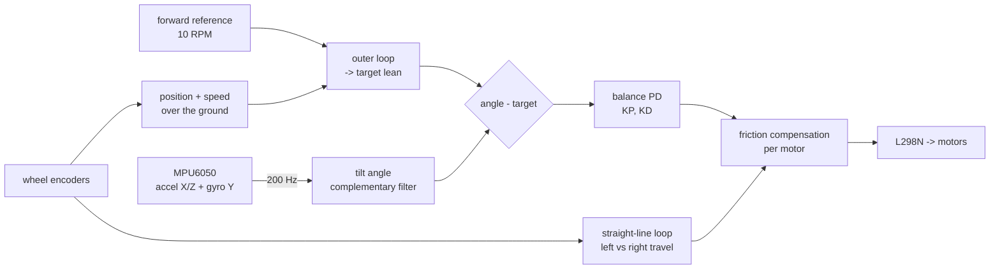
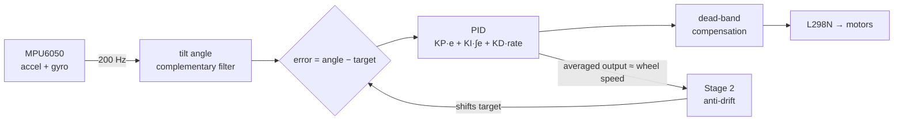

# BalanceX — Self-Balancing Robot

A two-wheeled robot that stands upright by itself. **Goal 1:** balance the bare chassis. **Goal 2:** balance with a 2 kg weight on the top tray.

## Current version: Arduino Uno R3 with wheel encoders

**Target:** balance steadily, then drive slowly forward in a straight line.

| Part | Used |
|---|---|
| Controller | Arduino Uno R3 |
| Tilt sensor | MPU6050 (I2C, A4/A5) |
| Motor driver | L298N dual H-bridge (ENA D5, ENB D6) |
| Motors | 2 × 12 V DC gear motors **with quadrature encoders** (1325.1 counts per wheel revolution) |
| Wheels | 70 mm (from the earlier spec; only used to convert RPM to cm/s) |
| Power | 3S LiPo (11.1 V) → fuse → switch → L298N + buck converter (5 V for the Uno) |

- Firmware: [`firmware/BalanceX_Uno/`](firmware/BalanceX_Uno/) (open `BalanceX_Uno.ino`; no libraries to install)
- Wiring: [docs/CONNECTIONS_UNO.md](docs/CONNECTIONS_UNO.md)
- Bring-up, sign checks and tuning: [docs/UNO_GUIDE.md](docs/UNO_GUIDE.md) **← start here**
- Why it was rewritten (vibration, slow reaction): [docs/ERROR_LOG.md](docs/ERROR_LOG.md) DEV-12 to DEV-17



What changed compared with the team's previous Uno sketch (details in the ERROR_LOG):

| Problem | Cause | Now |
|---|---|---|
| Vibration | PWM jumped 0 ↔ 80/100 at 0.25° lean; Serial printing froze the loop ~9 ms every 100 ms | Smooth, encoder-based friction compensation; printing never waits |
| Slow reaction | Effective KP ≈ 21, output capped at PWM 180, gyro filtered before integrating, 100 kHz sensor reads | KP 50 / KD 1.6 in plain PWM, cap 255, unfiltered gyro integration, 400 kHz register reads |
| Drifting / not straight | Speed loop and wheel sync disagreed in sign; speed sync cannot undo a turn | One sign convention + `t`/`i` checks + direction-fault stop; heading hold on travelled distance |

All calibration values of the previous sketch (pins, counts per revolution, encoder/motor/IMU signs, minimum PWM 80/100, start/fall limits) are kept in `config.h`.

Run the PC simulation (optional, any computer with g++): it runs the Uno controller against a physics model of the robot, compares it with the previous sketch, and sweeps 64 variants of the unmeasured values (weight, height, motors, gearbox play, battery, calibration error).

```
g++ -std=c++17 -O2 -o uno_sim_test tests/uno_sim_test.cpp && ./uno_sim_test
```

The Uno firmware type-checks without warnings against Arduino stand-in headers (gnu++11, as the Arduino IDE uses). It has **not** yet been compiled with the real AVR toolchain or run on the robot: upload it, then follow UNO_GUIDE step 3 before the first balance.

---

## Earlier version: ESP32 without encoders

| Part | Used |
|---|---|
| Controller | ESP32-WROOM-32 DevKit |
| Tilt sensor | MPU6050 (accelerometer + gyroscope, I2C) |
| Motor driver | L298N dual H-bridge |
| Motors | 2 × 12 V DC gear motors, 300 rpm, 1.4–1.5 A stall, no encoders (yet) |
| Wheels | 70 mm × 40 mm |
| Power | 3S LiPo (11.1 V) → switch → fuse → L298N + LM2596 (5 V for the ESP32) |

Wiring: [docs/CONNECTIONS.md](docs/CONNECTIONS.md)

## Folder layout

```
firmware/BalanceX_Uno/  Arduino Uno sketch (current version, with encoders)
  BalanceX_Uno.ino      hardware: MPU6050, encoders, L298N, serial commands, telemetry
  config.h              ALL pins, your calibration and the tuning values  <-- the file you edit
  balance.h             the controller (angle, outer loop, balance, straight line, safety)
firmware/BalanceX/      ESP32 sketch (earlier version, no encoders)
  BalanceX.ino          setup(), loop(), modes, safety, serial/Bluetooth commands
  config.h              ALL pins and tunable values
  control.h             tilt maths, complementary filter, PID, balance controller
  imu.h                 MPU6050 driver (registers, no library needed)
  motors.h              L298N driver (ESP32 core 2.x and 3.x)
docs/
  UNO_GUIDE.md          Uno: bring-up, sign checks, tuning   <-- start here
  CONNECTIONS_UNO.md    Uno wiring
  TUNING_GUIDE.md       ESP32: step-by-step bring-up and tuning
  ERROR_LOG.md          every error we hit, cause and fix (+ template for hardware testing)
  CONNECTIONS.md        ESP32 wiring
tests/
  uno_sim_test.cpp      Uno controller: physics simulation, old vs new, 64 variants, safety
  host_test.cpp         ESP32 controller: sensor sign maths + physics simulation
```

## Quick start (ESP32 version)

1. Arduino IDE 2.x + **esp32 by Espressif** board package (tested on 2.0.17 and 3.3.12). No extra libraries needed.
2. Open `firmware/BalanceX/BalanceX.ino`, select **ESP32 Dev Module**, upload.
3. Serial Monitor at **115200**, line ending **Newline**, type `help`.
4. Follow [docs/TUNING_GUIDE.md](docs/TUNING_GUIDE.md) **in order**. The sign checks (steps 2–5) come before any tuning.

None of the numbers are fixed. Every gain, limit and filter value is in `config.h` with a comment explaining it. The main ones can also be changed live over USB or Bluetooth (`kp 25`, `zero`, …), then saved with `show` + copy/paste.

## How it works (ESP32 version)



1. **Angle.** The accelerometer gives the tilt from gravity: never drifts, but noisy and fooled by acceleration. The gyro gives the tilt *rate*: smooth, but its integral drifts. The complementary filter combines them: `angle = α·(angle + rate·dt) + (1−α)·accelAngle`.
2. **PID.** Leaning forward → drive forward, under the robot. The D term uses the gyro rate directly. The I term is essential with PWM-driven DC motors (see [ERROR_LOG DEV-04](docs/ERROR_LOG.md#dev-04--simulation-the-first-gains-kp-15-ki-0-kd-05-made-the-robot-run-away-and-fall)).
3. **Stage 2.** If the robot keeps rolling one way, the target angle is tilted the other way so it slows down ([DEV-05](docs/ERROR_LOG.md#dev-05--simulation-with-ki-added-it-still-ran-away-accelerometer-fooled-by-acceleration)).
4. **Safety.** Motors start only after the robot is held upright for 0.5 s, stop beyond 35°, and stop at once if the sensor stops answering.

## What has been verified (ESP32 version)

| Check | Result |
|---|---|
| Compiles, ESP32 core **3.3.12**, all warnings on | ✅ 0 errors. 1 warning: `BluetoothSerial` deprecated (harmless, [DEV-02](docs/ERROR_LOG.md#dev-02--bluetooth-library-deprecation-warning-on-core-3x)) |
| Compiles, ESP32 core **2.0.17**, all warnings on | ✅ 0 errors, 0 warnings |
| Compiles with `USE_BLUETOOTH 0` on both cores | ✅ |
| Sensor sign maths, all 24 possible board mountings | ✅ `tests/host_test.cpp` |
| Physics simulation with your motor + wheel specs, default gains | ✅ balances; reversed motors fall, as they should |
| Same, across unknown weight (1–2 kg), centre of mass (6–20 cm), battery charge, gearbox efficiency | ✅ 105 / 108 variants, all 81 with centre of mass ≤ 15 cm ([DEV-11](docs/ERROR_LOG.md#dev-11--re-simulation-with-the-real-motors-the-first-defaults-were-too-weak-for-70-mm-wheels)) |
| **Running on the real robot** | ❌ **Not yet.** This is your step: follow TUNING_GUIDE and log results in ERROR_LOG Part D |

Run the PC test (optional, any computer with g++):

```
g++ -std=c++17 -O2 -o host_test tests/host_test.cpp && ./host_test
```

The simulation uses your motor and wheel specs. Weight, centre-of-mass height and gearbox friction are still guesses, and it has no gearbox backlash. It proves the signs and the controller logic and gives sensible starting gains; the real robot sets the final ones.

## Better ways to do this project

(Written for the ESP32 version. Item 1, wheel encoders, is done in the Uno version.)

In order of how much they would help, especially for the 2 kg goal:

1. **Wheel encoders (biggest improvement, you plan these anyway).** Without them, the robot can only guess its wheel speed from the PWM it sends. That's why it tends to drift and needs the Stage-2 workaround. With encoders you get a proper speed/position loop around the angle loop: it stands still in one spot, does not run away, and you can later make it drive and turn. Easiest route: the encoder version of the same motor (same size, shaft and rpm; usually a 6-wire connector), so the chassis and wheels stay the same. It is 4 extra wires (to free pins such as GPIO 32, 33, 34, 35) plus code using the ESP32's hardware pulse counter.
2. **Replace the L298N before the 2 kg stage.** Your motors stall at 1.4–1.5 A, which is inside the L298N's 2 A per channel, so it is **fine for balancing the bare chassis**. But it is an old bipolar-transistor driver that loses about 2–4 V of the 11.1 V battery as heat: roughly 20–35 % of the voltage your motors could get, and it hurts most when catching a heavy load. A MOSFET driver loses almost nothing; for 1.5 A-stall motors, e.g. two DRV8871 or DRV8874 boards (one per motor, both comfortably above 1.5 A). Avoid the popular TB6612FNG here: it is rated only 1.2 A continuous. It would use the same ESP32 pins with small code changes.
3. **Battery-voltage compensation.** As the LiPo drains from 12.6 V to about 10.5 V, the same PWM gives about 17 % less voltage, so the robot gets "lazier" during a session. A voltage divider to an ADC pin (GPIO 34/35) lets the code scale the PWM to keep the behaviour constant.
4. **Check the gearbox backlash.** Wiggle each wheel by hand. Play in the gears is the classic cause of small, never-ending wobbles in DC-motor balancing robots. Low-backlash motors make tuning much easier.
5. **Mount the sensor rigidly**, close to the robot's centre, away from the motors (vibration) and motor cables (I2C noise).
6. **Later: LQR instead of PID.** Once encoders give you wheel speed, a state-space controller (LQR) designed from a model of the robot handles angle and speed together. It is more systematic than hand-tuning two PID loops, and a strong topic for a project report.
7. **Alternative design (for a future version, not this one):** stepper motors (NEMA 17 + TMC2209 drivers) are popular for DIY balancing robots because they have no backlash and their speed is exact without encoders. The cost is weight, current draw and less torque at speed, so with a 2 kg payload a good DC motor + encoder + MOSFET driver is usually the better choice.

**Recommended path:** get the current hardware balancing with this code first. It will teach you the tuning and sign checks. Then add encoders, and replace the L298N before attempting the 2 kg payload.
